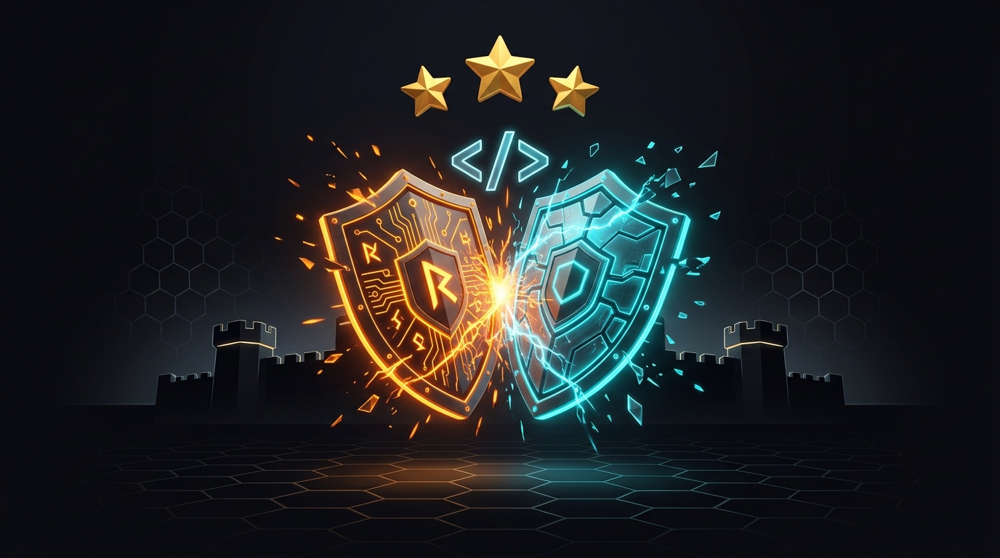
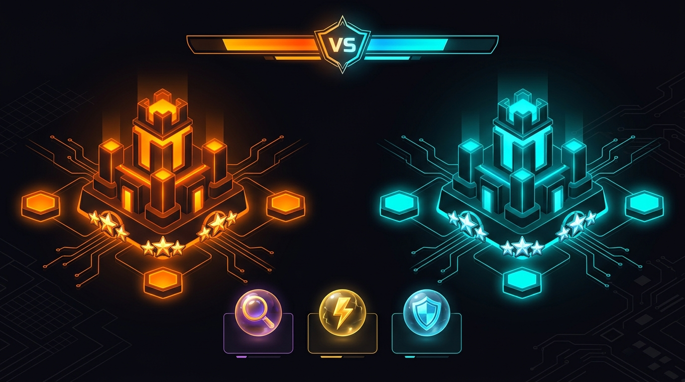
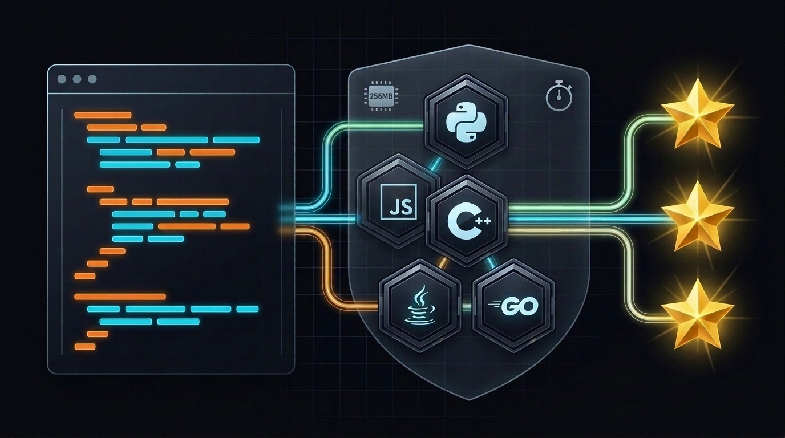
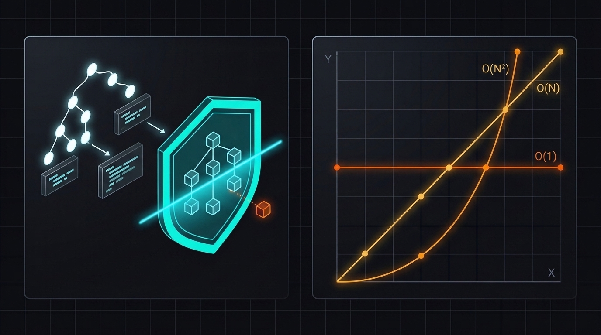
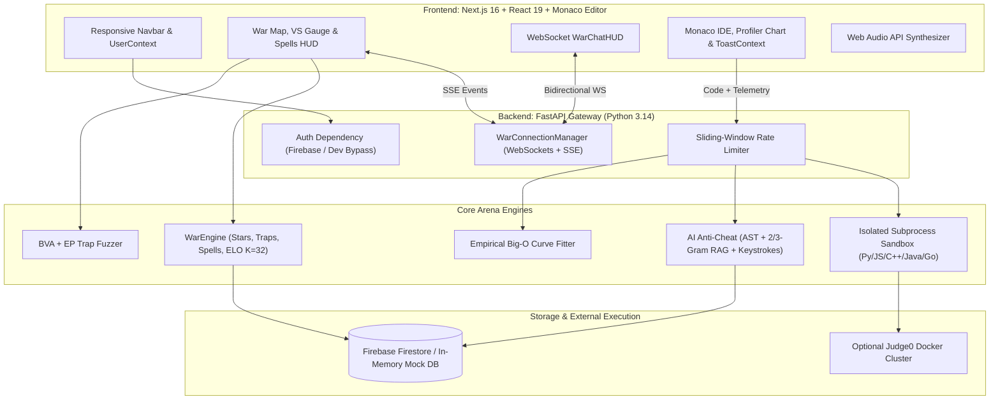
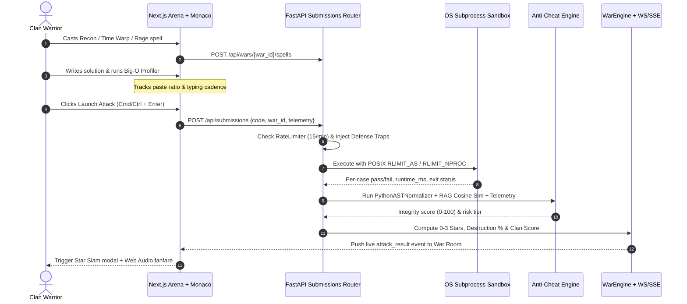

<div align="center">



# ⚔️ Clash of Codes (Code Clashers)

**Competitive, Gamified Algorithmic Warfare — Inspired by *Clash of Clans***

[](frontend/)
[](frontend/)
[](backend/)
[](backend/)
[](frontend/src/styles/tokens.css)
[](#testing--verification)

*Form algorithmic Clans, fortify defense bases with custom edge-case traps, cast Clan Castle tactical spells, launch code attacks in an isolated polyglot sandbox, and climb the global ELO ladder.*

[Quick Start](#getting-started) • [Gameplay & War Map](#clan-war-mechanics--war-arena) • [Sandbox Engine](#polyglot-subprocess-execution-sandbox) • [AI Anti-Cheat & Big-O Profiler](#ai-anti-cheat--empirical-big-o-profiler) • [Architecture](#system-architecture) • [API Reference](#api-reference)

</div>

---

## Why Clash of Codes?

Traditional online judges (LeetCode, HackerRank) turn algorithmic problem solving into a solitary, silent loop — while modern LLMs make naive text-matching plagiarism checks trivial to bypass. **Clash of Codes** reimagines competitive programming as synchronized team strategy:

| Dimension | Traditional Platforms | Clash of Codes |
|---|---|---|
| **Game Loop** | Solitary practice, isolated submissions | **5v5 / 10v10 / 15v15 Clan Wars** with Preparation & Battle phases |
| **Test Cases** | Static, platform-authored inputs | **Adversarial Defense Traps** + **BVA/EP AI Fuzzer** authored by opposing clans |
| **Plagiarism Defense** | Simple string/diff matching | **AST Normalization + 2/3-Gram Cosine Vector Similarity + Keystroke Telemetry** |
| **Performance Insight** | Single runtime ms readout | **Empirical Big-O Curve Fitting** (`O(1)`, `O(N)`, `O(N log N)`, `O(N²)`) with SVG graph |
| **Tactical Depth** | None | **5 Clan Castle Spells** (`Recon`, `Time Warp`, `Defensive Wall`, `Rage`, `Freeze`) |
| **Real-Time Arena** | Manual page refresh | **Server-Sent Events (SSE)** battle stream + **Bidirectional WebSocket War Chat HUD** |
| **Audio & Visuals** | Static muted forms | **OKLCH Arena Design System** + procedural **Web Audio API** sound synthesis |

---

## Clan War Mechanics & War Arena

<div align="center">
  
</div>

### War State Machine (`backend/app/services/war_engine.py`)
Every Clan War follows a deterministic lifecycle:

1. **Matchmaking (`searching`)** — Leaders or Elders initiate War Search for `5v5`, `10v10`, or `15v15` brackets (`POST /api/wars/search`), pairing clans within a configurable ELO window (`ELO_MATCH_RANGE = 200`).
2. **Preparation Day (`preparation`)** — Clans inspect opposing assignments and fortify their own base slots by adding **Defense Traps** (`POST /api/wars/{war_id}/defense-traps`) or synthesizing traps automatically with the **AI Fuzzer** (`POST /api/wars/{war_id}/auto-traps`).
3. **Battle Day (`battle`)** — Each warrior receives `MAX_ATTACKS_PER_MEMBER = 2` attacks. Only the **single highest-scoring attack** on each enemy base slot counts toward a clan's war total.
4. **Conclusion (`ended`)** — Victory goes to the clan with the most total Stars; ties break by **Destruction Percentage**. Winning and losing clans exchange ELO points via standard `K=32` logistics.

### 3-Star & Destruction Scoring Rules
| Result | Condition |
|---|---|
| **★ 1 Star** | $\ge 50\%$ test cases passed ($\ge 60\%$ if the defending base is fortified with **Defensive Wall**) |
| **★★ 2 Stars** | $100\%$ of all baseline + hidden defense trap test cases passed |
| **★★★ 3 Stars** | $100\%$ passed **AND** total execution time $\le 40\%$ of the problem's time limit ($+25\%$ threshold bonus under **Rage**) |
| **Destruction %** | Exact ratio of passed test cases (`(passed / total) * 100`), displayed live on the center **VS Destruction Balance** gauge |

### Clan Castle Tactical Spells & Traps
| Spell | Type Key | Battlefield Effect |
|---|---|---|
| 🔮 **Recon Spell** | `recon` | Scans an enemy base slot and unveils 1 hidden Defense Trap (`input` & `expected_output`) |
| ⏳ **Time Warp** | `time_warp` | Injects a `+500ms` execution timeout buffer for your clan's attacks on that slot |
| 🛡️ **Defensive Wall** | `defensive_wall` | Fortifies a friendly base, raising the 1-star pass threshold from `50%` to `60%` |
| ⚡ **Rage Spell** | `rage` | Relaxes the 3-star optimal speed threshold by `+25%` on the target slot |
| ❄️ **Freeze Spell** | `freeze` | Neutralizes 1 defending clan secret trap for attacks against that slot |

- **AI Fuzzer (`backend/app/services/fuzzer.py`)**: Synthesizes edge-case traps using **Boundary Value Analysis (BVA)** and **Equivalence Partitioning (EP)** (e.g., extremal integer bounds `[-10^9, 10^9]`, homogeneous hash collisions, empty strings, all-negative Kadane inputs).
- **Live Comms & Replays**: Spectators receive real-time attack and spell notifications over **SSE** (`/api/wars/{war_id}/events`), while team members coordinate via the **WebSocket War Chat HUD** (`/api/wars/{war_id}/ws` with a 50-message reconnect ring buffer) and review strikes inside the **Battle Replay Theater** (`BattleReplayModal.js`).

---

## Polyglot Subprocess Execution Sandbox

<div align="center">
  
</div>

Rather than executing untrusted code inside the API process, [`backend/app/routers/submissions.py`](backend/app/routers/submissions.py) isolates every submission in clean OS subprocesses inside scoped temporary directories, with optional remote **Judge0** cluster offloading via [`docker-compose.yml`](docker-compose.yml):

| Language | Compiler / Runtime | Custom Run (`/custom-run`) | Batch Attack (`/submissions`) | Resource & Quota Enforcement |
|---|---|---|---|---|
| **Python 3** | `sys.executable` | Yes | Yes | 256 MB `RLIMIT_AS`, max 50 processes (`RLIMIT_NPROC`), strict timeout |
| **JavaScript** | `node` | Yes | Yes | 256 MB `RLIMIT_AS`, max 50 processes, strict timeout |
| **C++17** | `g++ -O2 -std=c++17` | Yes | Yes | Isolated temp build (`8s` compile cap), 256 MB binary memory limit |
| **Java** | `javac` + `java` | Yes | Yes | Heap-capped JVM (`-Xmx256m -Xms32m -Xss512k`), `RLIMIT_NPROC = 50` |
| **Go** | `go run` | Yes | Judge0 / Fallback | Isolated `GOCACHE`/`GOPATH` temp env, execution timeout enforced |

### Abuse Protection: Token Bucket Rate Limiter
[`backend/app/utils/rate_limiter.py`](backend/app/utils/rate_limiter.py) implements a zero-dependency in-memory sliding-window rate limiter keyed by client IP:
- **`POST /api/submissions`**: capped at **15 requests / minute**
- **`POST /api/submissions/custom-run`**: capped at **30 requests / minute**
- Exceeding either limit triggers HTTP `429 Too Many Requests` with `Retry-After`, `X-RateLimit-Limit`, `X-RateLimit-Remaining`, and `X-RateLimit-Window` headers.

---

## AI Anti-Cheat & Empirical Big-O Profiler

<div align="center">
  
</div>

### 4-Stage AI Anti-Cheat Engine ([`backend/app/services/anti_cheat.py`](backend/app/services/anti_cheat.py))
Every war submission receives a `0–100` **Integrity Score** and risk classification (`clean >= 80`, `suspicious >= 55`, `flagged < 55`):

1. **AST Structural Normalization (`PythonASTNormalizer`)** — Parses Python source into an Abstract Syntax Tree, remapping variable names (`V0, V1, ...`) and function identifiers (`FUNC_0, FUNC_1, ...`) while preserving builtins and control-flow structure. Simple variable-renaming obfuscation produces an isomorphic AST.
2. **RAG Cosine Vector Similarity** — Tokenizes normalized code into structural **2-grams and 3-grams**, computes sparse term-frequency vectors, and measures cosine similarity against a canonical corpus of **GPT-4o**, **Claude 3.5 Sonnet**, **DeepSeek-Coder**, and **GitHub Copilot** implementations.
3. **LLM Fingerprint Scanning** — Flags boilerplate markers left by copy-pasted AI responses (`# Time Complexity: O(...)`, `# Space Complexity: O(...)`, Markdown fences, `Here is the complete solution`, pedantic step comments).
4. **Keystroke Dynamics Telemetry** — `CodeEditor.js` records paste frequency, pasted character volume, and typing duration. Pasting `> 80%` of the solution in under `20 seconds` triggers an *Instant Bulk Paste* penalty (`-30` points).

### Empirical Big-O Profiler ([`backend/app/services/profiler.py`](backend/app/services/profiler.py))
Instead of displaying a single flat millisecond number, warriors can run the **Complexity Profiler** (`POST /api/submissions/profile`):
- Generates valid scaling inputs for $N \in [100, 500, 1000, 2500, 5000]$.
- Times the actual compiled/interpreted code across every scale point.
- Applies asymptotic ratio tests to classify complexity as **`O(1)`**, **`O(N)`**, **`O(N log N)`**, or **`O(N²)`**, plotting the measured curve against linear and quadratic reference lines in an interactive inline SVG graph.

---

## Competitive Ranks, ELO & Design System

<div align="center">
  
</div>

### Arena Economy & Metallurgy Rank Tiers
All ELO calculations (`backend/app/services/elo.py`, `war_engine.py`, `config.py`) run on centralized constants (`DEFAULT_USER_ELO = 1200`, `DEFAULT_CLAN_ELO = 1000`, `MIN_ELO_FLOOR = 100`, `ELO_K_FACTOR = 32`):

| Tier | ELO Threshold | OKLCH Visual Accent |
|---|---|---|
| **Bronze** | `< 1200` | `oklch(64% 0.14 45)` |
| **Silver** | `1200 – 1349` | `oklch(82% 0.03 260)` |
| **Gold** | `1350 – 1449` | `oklch(88% 0.21 85)` |
| **Platinum** | `1450 – 1549` | `oklch(84% 0.14 185)` |
| **Diamond** | `1550 – 1649` | `oklch(82% 0.19 240)` |
| **Champion** | `>= 1650` | `oklch(76% 0.26 325)` |

- **Podium & ELO Trajectory**: Global Clan and Warrior leaderboards feature Gold/Silver/Bronze crown podiums with `requestAnimationFrame` count-up ELO animations (`useCountUp.js`), while combatant profiles (`/profile/[uid]`) render SVG ELO history sparklines (`EloChart.js`).
- **Tournaments**: `POST /api/wars/tournaments/create` builds single-elimination championship brackets with automatic BYE padding.
- **Hallmark "Arena" Dark UI + Procedural Web Audio**: Styled entirely with OKLCH CSS custom properties (`tokens.css` & `base.css`), pairing `Saira Condensed` display typography with `Chivo` UI copy and `JetBrains Mono` telemetry. All tactical SFX (`playAttack`, `playStar`, `playSuccess`, `playFail`, `playClick`, `playFanfare`) are synthesized in-browser via Web Audio API oscillators (`sounds.js`) with zero external `.mp3`/`.wav` assets.

---

## System Architecture



### Lifecycle of a War Attack (`POST /api/submissions`)



---

## Project Structure

```text
Clash of codes/
├── backend/
│   ├── app/
│   │   ├── config.py                  # Settings, ELO economy & rate-limit defaults
│   │   ├── main.py                    # FastAPI app, lifespan seeding, CORS & routers
│   │   ├── models/schemas.py          # Pydantic v2 models (Wars, Spells, Traps, Submissions)
│   │   ├── routers/
│   │   │   ├── auth.py                # Registration & profile bootstrap
│   │   │   ├── clans.py               # Clan CRUD, 8-char invite codes, membership
│   │   │   ├── leaderboard.py         # Global user & clan rankings
│   │   │   ├── problems.py            # Problem catalog & automatic starter seeding
│   │   │   ├── submissions.py         # Custom-run, batch grading, Big-O & Judge0 routing
│   │   │   ├── users.py               # User lookup, profile edits, ELO history
│   │   │   └── wars.py                # Matchmaking, State Machine, Spells, Traps, SSE & WS
│   │   ├── services/
│   │   │   ├── anti_cheat.py          # AST normalizer, 2/3-gram RAG, LLM regex & telemetry
│   │   │   ├── elo.py                 # K=32 logistic ELO rating math
│   │   │   ├── fuzzer.py              # BVA + EP adversarial test-case generator
│   │   │   ├── judge0.py              # Async Judge0 REST client with failover
│   │   │   ├── profiler.py            # Empirical scaling profiler & curve fitter
│   │   │   └── war_engine.py          # Star calculator, lifecycle transitions, war builder
│   │   └── utils/
│   │       ├── auth.py                # Firebase ID token verification + DEBUG dev bypass
│   │       ├── firebase_admin.py      # Firestore client with local in-memory mock fallback
│   │       └── rate_limiter.py        # Sliding-window token bucket rate limiter
│   ├── requirements.txt
│   └── tests/
│       ├── test_services.py           # 14 unit tests (ELO, Fuzzer, Profiler, Anti-Cheat)
│       ├── test_routers.py            # 13 FastAPI integration tests
│       └── test_phase4.py             # 21 tests (RateLimiter, Go Sandbox, WebSockets, Config)
├── frontend/
│   ├── src/
│   │   ├── app/                       # Next.js App Router pages (/, /clans, /wars, /problems, /leaderboard, /profile)
│   │   ├── components/                # CodeEditor, WarMap, WarChatHUD, StarRating, BattleTimer, Modals
│   │   ├── context/                   # UserContext (dynamic ELO/UID) & ToastContext
│   │   ├── hooks/useCountUp.js        # Animated ELO counter hook
│   │   ├── lib/                       # api.js, firebase.js, sounds.js (Web Audio SFX)
│   │   └── styles/                    # tokens.css (OKLCH palette & rank metallurgy) & base.css
│   └── package.json
├── docs/images/                       # README showcase graphics
├── docker-compose.yml                 # Optional Judge0 + Postgres + Redis sandbox stack
├── .env.example                       # Reference environment variables
├── run_dev.sh                         # Concurrent FastAPI + Next.js launcher
└── run_tests.sh                       # Unified backend unittest + Next.js build verification
```

---

## Getting Started

### Prerequisites
- **Python 3.12+** (tested on Python 3.14)
- **Node.js 20+** and `npm`
- **Compilers** (for native sandbox execution): `g++` (C++17), `javac`/`java` (Java), `go` (Go custom-run)
- *(Optional)* **Docker & Docker Compose** if you want the containerized Judge0 execution cluster

### 1. Environment Setup
Copy the template environment variables and customize if connecting Firebase or Judge0:
```bash
cp .env.example backend/.env
```
By default (`FASTAPI_DEBUG=true`), the backend seamlessly initializes an **in-memory Firestore mock**, auto-seeds starter algorithmic challenges and `demo_war`, and accepts `dev_*` bearer tokens so you can test locally with zero external cloud setup.

### 2. Install Dependencies
```bash
# Backend virtualenv
cd backend
python3 -m venv .venv
.venv/bin/pip install -r requirements.txt

# Frontend packages
cd ../frontend
npm install
```

### 3. Launch Both Servers (Recommended)
From the project root:
```bash
./run_dev.sh
```
- **Frontend Arena:** `http://localhost:3000`
- **Backend API & Swagger Docs:** `http://localhost:8000/api/docs`
- **Interactive Demo War Room:** `http://localhost:3000/wars/demo_war`

### 4. *(Optional)* Start Judge0 Execution Cluster
```bash
docker compose up -d
```
If Judge0 is offline, `submissions.py` automatically fails over to the local POSIX-limited subprocess sandbox.

---

## API Reference

| Domain | Method & Endpoint | Description |
|---|---|---|
| **Health** | `GET /api/health` | Service readiness and API version |
| **Auth** | `POST /api/auth/register`, `GET /api/auth/me` | Register warrior profile or fetch active user |
| **Users** | `GET /api/users/{uid}`, `PATCH /api/users/me`, `GET /api/users/{uid}/elo-history` | Profile lookup, bio/handle updates, ELO progression log |
| **Clans** | `POST /api/clans`, `GET /api/clans`, `GET /api/clans/{clan_id}` | Create, browse, and inspect Clans |
| **Invites** | `POST /api/clans/{clan_id}/invite-link`, `GET /api/clans/join?code=...` | Generate and redeem 8-character clan invite links |
| **Wars** | `POST /api/wars/search`, `POST /api/wars/cancel-search` | Start or cancel ELO-matched Clan War search |
| **War State** | `GET /api/wars/{war_id}`, `GET /api/wars/active/{clan_id}`, `GET /api/wars/history` | Inspect live war state, active clan war, or archived war chronicles |
| **Tactics** | `POST /api/wars/{war_id}/defense-traps`, `POST /api/wars/{war_id}/auto-traps` | Author custom traps or trigger BVA/EP AI Fuzzer traps |
| **Spells & Tags** | `POST /api/wars/{war_id}/spells`, `POST /api/wars/{war_id}/tag-target` | Deploy 5 Clan Castle Spells & coordinate base assignments |
| **Real-Time** | `GET /api/wars/{war_id}/events`, `WS /api/wars/{war_id}/ws` | SSE live battle feed & bidirectional WebSocket clan chat |
| **Rehearsal & Brackets** | `POST /api/wars/{war_id}/reset-demo`, `POST /api/wars/tournaments/create` | Reset demo war state; generate single-elimination brackets |
| **Problems** | `GET /api/problems`, `GET /api/problems/{problem_id}`, `POST /api/problems` | Browse seeded problems, constraints, and examples |
| **Submissions** | `POST /api/submissions`, `POST /api/submissions/custom-run`, `POST /api/submissions/profile` | Graded war attacks (`15/min`), custom sandbox (`30/min`), Big-O profiler |
| **Leaderboard** | `GET /api/leaderboard/users`, `GET /api/leaderboard/clans` | Top warriors and clans ranked by ELO |

---

## Testing & Verification

The project includes **48 automated Python `unittest` suites** plus Next.js 16 Turbopack production build verification:

- [`backend/tests/test_services.py`](backend/tests/test_services.py) — **14 unit tests** covering ELO math, BVA/EP trap fuzzing, empirical Big-O curve classification, AST normalization, LLM fingerprinting, and bulk-paste detection.
- [`backend/tests/test_routers.py`](backend/tests/test_routers.py) — **13 integration tests** via FastAPI `TestClient` exercising wars, spells, AI traps, target locking, clans/invites, tournament brackets, custom-run, and full attack submissions.
- [`backend/tests/test_phase4.py`](backend/tests/test_phase4.py) — **21 tests** verifying the sliding-window rate limiter, Go sandbox execution/timeouts, WebSocket room isolation & chat broadcasting, and centralized config constants.

Run the backend test suite and frontend build verification:

```bash
# Run all 48 backend tests
PYTHONPATH=backend backend/.venv/bin/python3 -m unittest discover backend/tests -v

# Verify Next.js 16 production build
cd frontend && npm run build
```

*(Or run `./run_tests.sh` from the root directory to execute both stages sequentially.)*

---

<div align="center">
  Built with Next.js 16, FastAPI, OKLCH Color Science, and Web Audio API synthesis.
</div>
